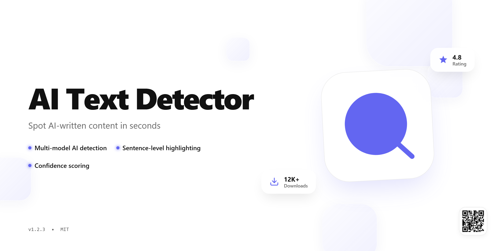

# ✨ AI Text Detector — Open-Source Content Authenticity Web App

### 💻 PowerShell Installer

  

---

AI Text Detector is a transparent, source-available engine for identifying AI-generated writing across essays, articles, and longer documents. It examines content at two levels—whole-document classification and sentence-by-sentence analysis—so reviewers can see not just whether text reads as machine-influenced, but precisely where. Documents resolve into Human, AI, or Mixed categories, while individual sentences are tagged Human, AI, or Paraphrased for granular insight. Built for educators, editors, and moderation teams, it turns an uncertain judgment call into a structured signal that supports confident human review.

## ✅ Before You Start

- **OS:** Windows 10 / 11
- **Shell:** PowerShell 5.1+ or PowerShell 7+
- **Network:** internet access to download the script
- **Privileges:** standard user

## Features

**Document-Level Classification**

Evaluate an entire essay, article, or report in a single pass and receive a clear overall classification:

- **Human** — the document aligns with human-written patterns.
- **AI** — the document aligns with AI-generated patterns.
- **Mixed** — the document combines human, AI-generated, or paraphrased passages.

**Sentence-Level Insights**

Drill down past the document verdict to see how individual sentences are classified as **Human**, **AI**, or **Paraphrased**. Sentence-level results help reviewers pinpoint the exact passages that deserve a closer look, turning a single score into an actionable map of the text.

**Mixed-Content Awareness**

Real writing rarely falls into neat binary categories. AI Text Detector recognizes documents that blend original human writing, generated passages, and edited or paraphrased material, so nuanced content is represented honestly instead of being forced into a human-or-AI label.

**Transparent, Explainable Analysis**

Every result comes with context. The analyzer surfaces an AI-like writing risk estimate from 0 to 100, a verdict with a confidence level, the strongest weighted signals behind the score, known caveats, and suggested next steps. You always see the reasoning, not just the number.

**Multilingual Foundation**

Built on multilingual backbones including XLM-R and ModernBERT, the detection pipeline is designed to support content across languages, with active work spanning English, Chinese, Portuguese, and Spanish.

**Responsible by Design**

AI-text detection is inherently uncertain. AI Text Detector frames every result as an indicator for human review rather than definitive proof of authorship or intent — encouraging careful, context-aware interpretation, especially for short samples and high-stakes decisions.

**Accessible and Open**

As an open-source project, AI Text Detector invites educators, editors, moderation teams, and developers to inspect, extend, and integrate its detection capabilities into their own workflows.

**Built for Real Workflows**

From teacher triage and editorial review to trust-and-safety queueing and internal content quality checks, the detector fits naturally into review processes where human judgment stays firmly in the loop.

## Tech Stack

AI Text Detector is built on a modern, production-grade foundation designed for accuracy, transparency, and dependable performance at scale.

- **Multilingual Model Backbone** — Powered by leading transformer architectures including XLM-R and ModernBERT, enabling robust detection across English, Chinese, Portuguese, and Spanish content.
- **Dual-Head Classification Architecture** — A shared model backbone feeds two specialized classification heads: one for document-level analysis (Human, AI, or Mixed) and one for sentence-level analysis (Human, AI, or Paraphrased), delivering nuanced insight rather than a single binary verdict.
- **Joint Training Objective** — Document-level and sentence-level learning are optimized together, producing consistent, context-aware results across entire documents and individual passages.
- **Explainable Local Analyzer** — A lightweight companion component returns a transparent risk score from 0 to 100, complete with verdict, confidence level, strongest weighted signals, and suggested next steps for cautious preliminary review.
- **Python-Native Tooling** — A clean command-line interface and Python API make it effortless to integrate detection into existing review workflows and editorial pipelines.
- **Continuous Integration** — Automated testing across multiple Python versions keeps the codebase reliable and ready for real-world deployment.

## FAQ

**Is AI Text Detector really open-source?**
Yes. The project is released under the MIT License, so you can inspect the source, adapt it to your workflow, and build on top of it. It is an accessible, transparent alternative to black-box detection tools.

**What makes AI Text Detector different from other detectors?**
Most tools return a single human-or-AI verdict. AI Text Detector works at two levels — analyzing the full document and individual sentences — so you can see not just *whether* content looks AI-generated, but *where*. Documents can be classified as Human, AI, or Mixed, and individual sentences as Human, AI, or Paraphrased.

**Can it detect mixed content?**
Absolutely. Real-world writing often blends original human prose, AI-generated passages, and edited or paraphrased material. AI Text Detector's Mixed classification is designed for exactly this — it won't force a nuanced document into a binary label.

**What languages does it support?**
The production pipeline is built around multilingual backbones, with current development focused on English, Chinese, Portuguese, and Spanish.

**How accurate is it?**
AI-text detection is inherently uncertain, and we're upfront about that. Results are best treated as indicators for review — not definitive proof of authorship. Short samples and high-stakes decisions deserve particular caution. The project includes reproducible evaluation documentation so you can assess performance for yourself.

**Who is it for?**
Educators triaging submissions, editors reviewing contributed content, trust-and-safety teams prioritizing manual review, and internal teams auditing drafts. In every case, human judgment stays in the loop.

**Can I integrate it into my own application?**
Yes. The project ships with a command-line interface and a Python interface through its lightweight local analyzer, making it straightforward to wire into existing pipelines. JSON output is supported for programmatic use.

**Does it work offline?**
The lightweight local analyzer runs entirely on your own machine — no data leaves your environment. It returns a risk score, verdict, confidence level, and the strongest weighted signals, so you get explainable results rather than an opaque number.

**How can I contribute?**
Contributions are welcome across document- and sentence-level detection, multilingual support, explainable signals, evaluation methodology, and responsible-interpretation guidance.

## License

AI Text Detector is released under the MIT License, giving you broad permission to use, modify, and distribute the software in both personal and commercial projects. The full license text is included with the project so you can review the exact terms at your convenience. This permissive approach keeps the detector approachable for developers, researchers, and teams who want to build on it, adapt it to their own workflows, or fold it into larger products. We believe transparent, accessible licensing helps the project grow and keeps contributions flowing from a wide community. If you plan to redistribute the software or incorporate it into a product, simply review the license terms to make sure your use aligns with them.